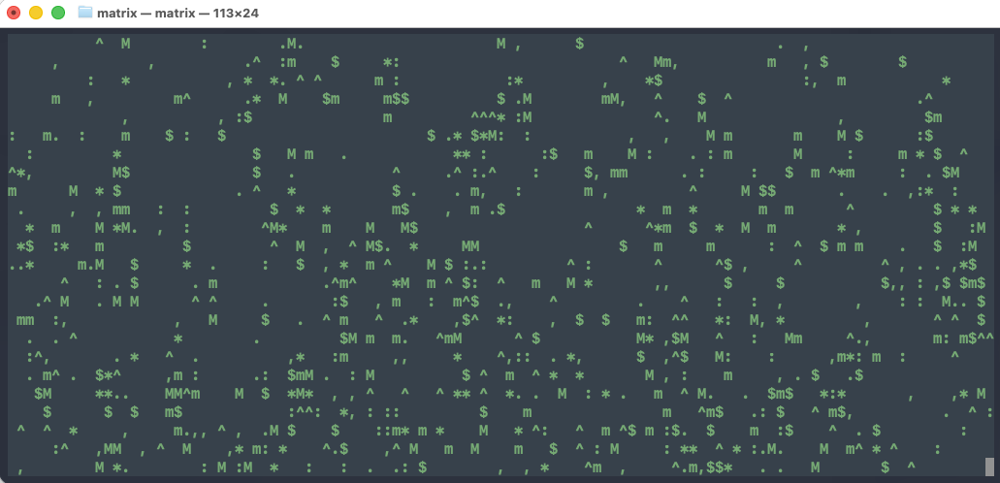

# The Matrix for your terminal :-)

Sunday evening, felt boring, wrote this.

License: see LICENSE file

Requires: `gcc`, `make`, `libncurses`

Run `make` to compile. Press **CTRL**+**C** to end.

Tested: macOS, should run fine with Linux
